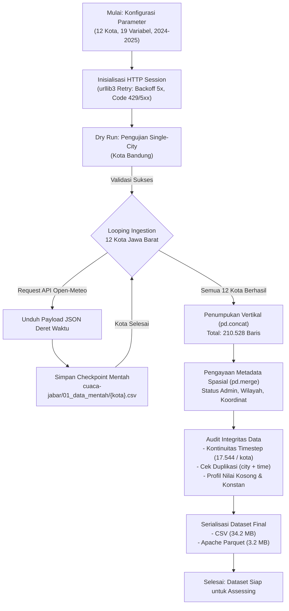

# 🌦️ Analisis dan Prediksi Pola Cuaca Jawa Barat untuk Mitigasi Banjir dan Dukungan Sektor Pertanian

<p align="center">
  
  
  
  
  
</p>

---

## 📌 Ringkasan Eksekutif & Konteks Proyek

Provinsi **Jawa Barat** memegang peran ganda yang sangat vital bagi perekonomian nasional: sebagai salah satu **lumbung pangan utama** Indonesia sekaligus wilayah dengan kerentanan tinggi terhadap **bencana hidrometeorologi** (banjir luapan sungai, banjir bandang, dan tanah longsor). Keragaman bentang alam—mulai dari wilayah pesisir dataran rendah Pantura, cekungan dataran tinggi Bandung Raya, hingga lereng vulkanik terjal Priangan—menciptakan variabilitas mikroklimat yang sangat dinamis antardaerah.

Proyek ini bertujuan untuk membangun pipeline analitik dan model prediktif berbasis **Big Data** guna:
1. **Mitigasi Risiko Banjir:** Menganalisis pola akumulasi presipitasi, intensitas hujan konvektif (*showers*), dan tekanan permukaan untuk sistem peringatan dini banjir di wilayah rawan genangan.
2. **Dukungan Agrikultur Presisi:** Memantau dinamika kelembapan udara, defisit tekanan uap air (*vapour pressure deficit / VPD*), dan suhu tanah berlapis (0 cm, 6 cm, 18 cm) untuk membantu penjadwalan irigasi, masa tanam, dan pencegahan hama pada sektor pertanian.

> [!IMPORTANT]
> **Mengapa Pendekatan Big Data & Resolusi Per Jam (*Hourly Data*)?**
> Fenomena cuaca ekstrem di wilayah tropis seperti hujan lebat lokal (*flash flood*) sering kali terjadi dalam rentang waktu beberapa jam saja. Agregat bulanan atau harian tidak mampu menangkap lonjakan intensitas ini. Dengan granularity **per jam (hourly)** pada 12 titik lokasi strategis selama 2 tahun penuh (2024–2025), dataset ini menghasilkan **210.528 baris data multivariat** yang terus bertumbuh (*velocity* & *volume* tinggi), memenuhi kriteria pengolahan data berskala besar.

---

## 👥 Tim Penyusun (Kelompok 7)

**Mata Kuliah:** Big Data  
**Topik Tugas:** Fiksasi Dataset & Data Wrangling (Tahap *Gathering Data*)

| No | Nama Mahasiswa | NIM | Peran Utama |
|:--:|:---|:---:|:---|
| 1 | **Hilarius Yoga Baskoro** | `101032300159` | Data Ingestion Pipeline & Checkpoint Architecture |
| 2 | **Wildan Janitra Ramadhan** | `101032300140` | Geospatial Metadata Modeling & Data Quality Validation |

---

## 🚦 Status & Kemajuan Proyek Saat Ini

Saat ini repositori telah menyelesaikan **Milestone 1 (Gathering Data)** dan **Milestone 2 (Data Assessing & Data Cleaning)**.

```
[x] Tahap 1: Fiksasi Masalah, Pemilihan Endpoint API, & Automated Data Gathering (SELESAI)
[x] Tahap 2: Data Assessing & Data Cleaning (Penanganan anomali, standarisasi tipe data, audit variabel) (SELESAI)
[ ] Tahap 3: Exploratory Data Analysis (EDA) & Analisis Korelasi Spasiotemporal Iklim Jawa Barat
[ ] Tahap 4: Feature Engineering & Baseline Predictive Modeling (Regresi Presipitasi & Klasifikasi Cuaca)
[ ] Tahap 5: Distributed Data Processing & ML Pipeline (Apache Spark / PySpark MLlib)
[ ] Tahap 6: Interactive Dashboard & Peringatan Dini Cuaca Jawa Barat
```

> [!NOTE]
> - Pada **Tahap 1 (Gathering)**, data mentah dikumpulkan secara apa adanya tanpa manipulasi nilai ke dalam `cuaca-jabar/02_dataset_final/` (26 kolom).
> - Pada **Tahap 2 (Assessing & Cleaning)**, dilakukan audit multi-dimensi dan pembersihan terukur (penghapusan 3 kolom konstan `province`, `snowfall`, `snow_depth`; rekonsiliasi fisik 41.223 baris `precipitation = rain + showers`; koreksi termodinamika 11 baris `dew_point_2m <= temperature_2m`; imputasi terstratifikasi 34.128 nilai kosong `precipitation_probability`; serta konversi tipe data semantik + penambahan `weather_label` WMO) yang disimpan ke `cuaca-jabar/03_dataset_clean/` (24 kolom bersih, 0 nilai kosong).

---

## 📊 Spesifikasi Teknis Dataset

Dataset final merupakan hasil agregasi deret waktu per jam dari 12 kota/kabupaten di Jawa Barat:

| Parameter | Spesifikasi Teknis |
|:---|:---|
| **Penyedia Data** | [Open-Meteo Weather API](https://open-meteo.com/en/docs/historical-forecast-api) |
| **Endpoint Gathering (Historis)** | `https://historical-forecast-api.open-meteo.com/v1/forecast` *(Data Training & Evaluasi 2024–2025)* |
| **Endpoint Pasangan (Real-Time)** | `https://api.open-meteo.com/v1/forecast` *(Live Current & Forecast untuk Sistem Peringatan Dini)* |
| **Lisensi Sumber** | Creative Commons Attribution 4.0 International (CC BY 4.0) |
| **Periode Observasi** | 1 Januari 2024 (00:00 WIB) – 31 Desember 2025 (23:00 WIB) |
| **Durasi Waktu** | 2 Tahun Penuh (731 hari, termasuk tahun kabisat 2024 = 17.544 jam/kota) |
| **Granularitas Waktu** | Per Jam (*Hourly*), Zona Waktu `Asia/Jakarta` (WIB / UTC+7) |
| **Jumlah Wilayah** | 12 Titik Kota/Kabupaten di Provinsi Jawa Barat |
| **Total Observasi** | **210.528 baris** ($12 \times 17.544$ jam) |
| **Total Fitur** | **26 kolom** (8 atribut metadata/geospasial + 18 variabel cuaca) |
| **Integritas Waktu** | **100% Kontinu** (0 jam kosong, 0 baris duplikat pasangan `[city, time]`) |
| **Format Penyimpanan** | **Apache Parquet** (~3.2 MB, terkompresi Snappy) & **CSV** (~34.2 MB) |

### 🔄 Kesesuaian Konteks Data Historis vs. Real-Time (*Dual-Endpoint Parity*)

Meskipun dataset utama proyek ini diambil dari arsip historis (2024–2025), pemilihan keluarga **Open-Meteo Forecast API** dirancang khusus agar mendukung siklus penuh dari **pelatihan model historis** hingga **peringatan dini *real-time*** tanpa perbedaan skema (*zero train-serve skew*):

| Konteks Penggunaan | Endpoint yang Digunakan | Karakteristik & Jangkauan Waktu | Peran dalam Tahapan Proyek |
|:---|:---|:---|:---|
| **Data Historis (*Batch Archive*)** | `historical-forecast-api.open-meteo.com/v1/forecast` | Menyimpan arsip permanen deret waktu per jam masa lalu (2021 s.d. H-1) menggunakan parameter `start_date` dan `end_date`. | **Tahap 1–5:** *Data Gathering* (210.528 baris), *Assessing & Cleaning*, EDA spasiotemporal, serta pelatihan & pengujian model Machine Learning. |
| **Data Terbaru & Real-Time (*Live Stream*)** | `api.open-meteo.com/v1/forecast` | Menyediakan kondisi cuaca **saat ini (`current`, diperbarui tiap 15 menit)**, *lookback* hingga 92 hari terakhir (`past_days`), serta prakiraan 1–16 hari ke depan (`forecast_days`). | **Tahap 5–6:** *Real-time inference* pada **Dashboard Peringatan Dini Banjir & Agrikultur** menggunakan ke-18 variabel, satuan, dan titik koordinat grid yang **100% identik** dengan dataset historis. |

---

## 🗺️ Cakupan Spasial Wilayah Pengamatan

Pengambilan data merepresentasikan 12 simpul utama wilayah aglomerasi dan pusat aktivitas ekonomi di Jawa Barat dengan rentang elevasi yang beragam (7 mdpl hingga 767 mdpl):

| No | Kota / Kabupaten | Status Administratif | Wilayah Aglomerasi | Garis Lintang (°S) | Garis Bujur (°E) | Elevasi (mdpl) | Total Baris |
|:--:|:---|:---|:---|:---:|:---:|:---:|:---:|
| 1 | **Bandung** | Kota | Bandung Raya | `-6.9244` | `107.6054` | 703 m | 17.544 |
| 2 | **Cimahi** | Kota | Bandung Raya | `-6.8541` | `107.5148` | 767 m | 17.544 |
| 3 | **Bogor** | Kota | Bodebek | `-6.5729` | `106.8514` | 237 m | 17.544 |
| 4 | **Depok** | Kota | Bodebek | `-6.4323` | `106.8231` | 87 m | 17.544 |
| 5 | **Bekasi** | Kota | Bodebek | `-6.2214` | `107.0067` | 19 m | 17.544 |
| 6 | **Cirebon** | Kota | Pantura | `-6.7135` | `108.5450` | 7 m | 17.544 |
| 7 | **Sukabumi** | Kota | Jawa Barat Selatan | `-6.9244` | `106.9224` | 578 m | 17.544 |
| 8 | **Cianjur** | Kabupaten | Jawa Barat Tengah | `-6.8541` | `107.1356` | 453 m | 17.544 |
| 9 | **Tasikmalaya** | Kota | Priangan Timur | `-7.3462` | `108.2288` | 355 m | 17.544 |
| 10 | **Banjar** | Kota | Priangan Timur | `-7.3462` | `108.5339` | 37 m | 17.544 |
| 11 | **Garut** | Kabupaten | Priangan Timur | `-7.2056` | `107.8934` | 719 m | 17.544 |
| 12 | **Purwakarta** | Kabupaten | Purwasuka | `-6.5729` | `107.4559` | 88 m | 17.544 |

---

## 📖 Kamus Data (Data Dictionary)

Dataset terdiri dari **26 kolom** yang dikelompokkan ke dalam 4 domain informasi:

### 1. Metadata Spasial & Temporal (8 Kolom)
| Kolom | Tipe Data | Keterangan |
|:---|:---|:---|
| `city` | `string` | Nama wilayah kota atau kabupaten pengamatan |
| `status_administratif` | `string` | Status pemerintahan daerah (`Kota` / `Kabupaten`) |
| `region` | `string` | Pengelompokan wilayah aglomerasi Jawa Barat |
| `province` | `string` | Nama provinsi induk (`Jawa Barat`) |
| `latitude` | `float64` | Koordinat lintang titik referensi Open-Meteo |
| `longitude` | `float64` | Koordinat bujur titik referensi Open-Meteo |
| `elevation_m` | `float64` | Ketinggian lokasi di atas permukaan laut (meter) |
| `time` | `string / ISO 8601` | Cap waktu per jam waktu lokal (`YYYY-MM-DDTHH:MM`, WIB) |

### 2. Parameter Atmosfer & Permukaan (8 Kolom)
| Kolom | Tipe Data | Satuan | Keterangan |
|:---|:---|:---:|:---|
| `temperature_2m` | `float64` | °C | Suhu udara aktual pada ketinggian 2 meter |
| `relative_humidity_2m` | `int64` | % | Kelembapan relatif udara pada ketinggian 2 meter |
| `dew_point_2m` | `float64` | °C | Titik embun udara pada ketinggian 2 meter |
| `surface_pressure` | `float64` | hPa | Tekanan atmosferik di permukaan tanah |
| `cloud_cover` | `int64` | % | Persentase total tutupan awan di langit |
| `visibility` | `float64` | meter | Jarak pandang horizontal |
| `wind_speed_10m` | `float64` | km/jam | Kecepatan hembusan angin pada ketinggian 10 meter |
| `weather_code` | `int64` | Kode WMO | Kode klasifikasi cuaca standar *World Meteorological Organization* |

### 3. Parameter Hidrologi & Presipitasi — Mitigasi Banjir (6 Kolom)
| Kolom | Tipe Data | Satuan | Keterangan |
|:---|:---|:---:|:---|
| `precipitation` | `float64` | mm | Akumulasi presipitasi total (hujan stratiform + hujan konvektif) |
| `rain` | `float64` | mm | Curah hujan dari sistem awan skala besar/luas (*stratiform*) |
| `showers` | `float64` | mm | Curah hujan konvektif berdurasi pendek dan intensitas tinggi |
| `precipitation_probability` | `float64` | % | Estimasi probabilitas keterjadian presipitasi |
| `snowfall` | `float64` | cm | Presipitasi salju (*audit: bernilai 0 konstan di iklim tropis*) |
| `snow_depth` | `float64` | meter | Ketebalan akumulasi salju (*audit: bernilai 0 konstan di iklim tropis*) |

### 4. Parameter Tanah & Biosfer — Dukungan Sektor Pertanian (4 Kolom)
| Kolom | Tipe Data | Satuan | Keterangan & Relevansi Agrikultur |
|:---|:---|:---:|:---|
| `vapour_pressure_deficit` | `float64` | kPa | Defisit tekanan uap (VPD). Mengukur kapasitas udara menarik kelembapan; indikator utama transpirasi tanaman dan stres air. |
| `soil_temperature_0cm` | `float64` | °C | Suhu permukaan tanah langsung |
| `soil_temperature_6cm` | `float64` | °C | Suhu tanah kedalaman perakaran dangkal (6 cm) |
| `soil_temperature_18cm` | `float64` | °C | Suhu tanah kedalaman perakaran madya/dalam (18 cm) |

---

## 🛠️ Arsitektur Pipeline Pengumpulan Data (Data Pipeline)

Proses penarikan data mentah dirancang dengan prinsip **ketahanan data (*fault tolerance*)** dan **reproducibility** menggunakan Python:



### Keunggulan Teknis Pipeline:
1. **Exponential Backoff & Rate Limit Resilience:** Menggunakan `HTTPAdapter` dengan strategi retry terotomasi untuk meredam respons HTTP `429 (Too Many Requests)` dan server error (`500, 502, 503, 504`).
2. **Atomic Checkpointing:** Setiap kota langsung disimpan sebagai berkas CSV mandiri di [01_data_mentah/](./cuaca-jabar/01_data_mentah/) sesaat setelah diunduh. Jika koneksi terputus di tengah jalan, proses tidak perlu mengulang dari kota pertama.
3. **Dual Storage Architecture:**
   - **Apache Parquet (`.parquet`):** Menggunakan kompresi kolumnar Snappy. Mengurangi beban penyimpanan hingga **~90%** (3.2 MB vs 34.2 MB) dan mempercepat pemrosesan query analitik berbasis memori (PySpark/Polars/DuckDB).
   - **CSV (`.csv`):** Menjamin kompatibilitas lintas platform untuk audit manual dan pemenuhan spesifikasi tugas akademik.

---

## 📁 Struktur Direktori Repositori

```text
big-data-kelompok-7-weather/
│
├── Gathering_Data_Cuaca_Jabar_Kelompok7.ipynb          # Notebook Tahap 1: Pengumpulan & integrasi data mentah
├── Assessing_Cleaning_Data_Cuaca_Jabar_Kelompok7.ipynb # Notebook Tahap 2: Audit kualitas & pembersihan data
├── README.md                                           # Dokumentasi komprehensif proyek (berkas ini)
│
└── cuaca-jabar/                                        # Direktori data utama
    ├── 01_data_mentah/                                 # Berkas checkpoint CSV per kota (12 berkas, 23 kolom)
    │   ├── bandung_2024_2025.csv
    │   ├── banjar_2024_2025.csv
    │   ├── bekasi_2024_2025.csv
    │   ├── bogor_2024_2025.csv
    │   ├── cianjur_2024_2025.csv
    │   ├── cimahi_2024_2025.csv
    │   ├── cirebon_2024_2025.csv
    │   ├── depok_2024_2025.csv
    │   ├── garut_2024_2025.csv
    │   ├── purwakarta_2024_2025.csv
    │   ├── sukabumi_2024_2025.csv
    │   └── tasikmalaya_2024_2025.csv
    │
    ├── 02_dataset_final/                               # Dataset gabungan hasil Gathering (26 kolom, raw integrated)
    │   ├── cuaca_jabar_12kota_2024_2025.csv            # Format CSV (34.2 MB, 210.528 baris)
    │   └── cuaca_jabar_12kota_2024_2025.parquet        # Format Parquet (3.2 MB, terkompresi)
    │
    └── 03_dataset_clean/                               # Dataset bersih hasil Assessing & Cleaning (24 kolom, 0 NaN)
        └── cuaca_jabar_12kota_2024_2025_clean.csv      # Format CSV bersih (34.5 MB, 210.528 baris x 24 kolom)
```

---

## 🚀 Panduan Memulai (Quickstart)

### 1. Prasyarat Lingkungan
Pastikan Anda telah menginstal **Python 3.10+**. Direkomendasikan membuat virtual environment:

```bash
# Buat virtual environment
python -m venv venv

# Aktivasi virtual environment
# Windows (PowerShell):
.\venv\Scripts\Activate.ps1
# Linux / macOS:
source venv/bin/activate
```

### 2. Instalasi Pustaka Dependensi
Pasang pustaka pendukung untuk eksekusi notebook dan manipulasi dataset:

```bash
pip install pandas pyarrow fastparquet requests urllib3 jupyterlab
```

### 3. Membaca Dataset Final
Anda dapat langsung membaca dataset final menggunakan format Parquet yang efisien:

```python
import pandas as pd

# Membaca dataset Parquet berkecepatan tinggi
df = pd.read_parquet("cuaca-jabar/02_dataset_final/cuaca_jabar_12kota_2024_2025.parquet")

print(f"Total Baris : {df.shape[0]:,}")
print(f"Total Fitur : {df.shape[1]}")
print(f"Kota Tersedia: {df['city'].unique().tolist()}")
display(df.head())
```

Atau menggunakan pustaka **Polars** untuk komputasi Big Data modern:

```python
import polars as pl

# Lazy evaluation untuk dataset besar
lf = pl.scan_parquet("cuaca-jabar/02_dataset_final/cuaca_jabar_12kota_2024_2025.parquet")
agregat_hujan = (
    lf.group_by(["region", "city"])
    .agg(pl.col("precipitation").sum().alias("total_curah_hujan_mm"))
    .collect()
)
print(agregat_hujan)
```

### 4. Menjalankan Ulang Pipeline Pengumpulan & Pembersihan Data
1. **Tahap 1 (Gathering Data):** Buka notebook [Gathering_Data_Cuaca_Jabar_Kelompok7.ipynb](./Gathering_Data_Cuaca_Jabar_Kelompok7.ipynb) melalui Jupyter Lab atau Google Colab, kemudian jalankan seluruh sel secara berurutan (*Run All*).
2. **Tahap 2 (Assessing & Cleaning Data):** Buka notebook [Assessing_Cleaning_Data_Cuaca_Jabar_Kelompok7.ipynb](./Assessing_Cleaning_Data_Cuaca_Jabar_Kelompok7.ipynb) untuk menjalankan audit kualitas data multi-dimensi dan menghasilkan dataset bersih di `cuaca-jabar/03_dataset_clean/`.

---

## 📅 Roadmap Tahapan Proyek (Big Data Pipeline)

| Tahap | Milestone | Agenda & Deliverables | Status |
|:---:|:---|:---|:---:|
| **1** | **Dataset Fixation & Data Gathering** | Penarikan data Open-Meteo per jam (2024–2025), checkpoint per kota, penggabungan tabel, dan verifikasi integritas teknis. | ✅ Selesai |
| **2** | **Data Assessing & Cleaning** | Audit missing value (`precipitation_probability`), penghapusan kolom konstan (`snowfall`, `snow_depth`, `province`), rekonsiliasi fisik `precipitation = rain + showers`, konversi tipe kategorik `weather_code` + `weather_label`, dan evaluasi pencilan (*outliers*). | ✅ Selesai |
| **3** | **Exploratory Data Analysis (EDA)** | Analisis tren iklim multivariat, korelasi suhu tanah vs suhu permukaan, disparitas curah hujan pesisir vs pegunungan, visualisasi pola musiman. | 🔄 Selanjutnya |
| **4** | **Feature Engineering & Preprocessing** | Pembuatan lag features waktu (t-1, t-3, t-6 jam), agregasi moving window, pengkodean spasial, serta normalisasi fitur numerik. | ⏳ Terjadwal |
| **5** | **Big Data ML Modeling (PySpark / Scikit-Learn)** | Pembangunan model prediksi curah hujan ekstrem (Regresi) dan klasifikasi kondisi cuaca ekstrem berbasis distributed computing. | ⏳ Terjadwal |
| **6** | **Dashboard & Final Reporting** | Pengembangan antarmuka visualisasi interaktif untuk pemantauan peringatan banjir dan panduan agrikultur Jawa Barat. | ⏳ Terjadwal |

---

## 📜 Lisensi & Atribusi Data

- **Atribusi Data Cuaca:** Seluruh data cuaca historis bersumber dari **[Open-Meteo](https://open-meteo.com)** dan digunakan di bawah lisensi terbuka [Creative Commons Attribution 4.0 International (CC BY 4.0)](https://creativecommons.org/licenses/by/4.0/).
- **Kode Sumber Repositori:** Proyek ini dikembangkan untuk tujuan edukasi akademik pada mata kuliah Big Data. Hak cipta kode © 2026 Kelompok 7 Big Data.
