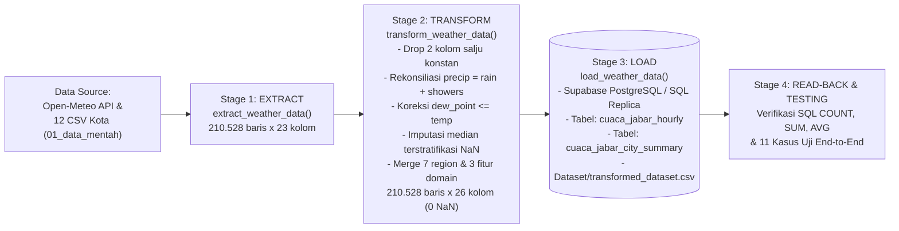

# DOKUMENTASI IMPLEMENTASI ETL PIPELINE (TUGAS MINGGU 10)
## Studi Kasus: Analisis dan Prediksi Pola Cuaca Jawa Barat untuk Mitigasi Banjir dan Dukungan Sektor Pertanian

**Mata Kuliah:** Big Data  
**Kelompok:** 7  
**Anggota Kelompok:**
1. **Hilarius Yoga Baskoro** — `101032300159`
2. **Wildan Janitra Ramadhan** — `101032300140`

---

## a. Informasi Studi Kasus dan Dataset

### 1. Deskripsi Singkat Studi Kasus dan Tujuan Pengolahan Data
Provinsi Jawa Barat merupakan salah satu lumbung pangan utama nasional sekaligus wilayah dengan risiko bencana hidrometeorologi (banjir luapan sungai dan banjir bandang) tertinggi di Indonesia. Kejadian hujan ekstrem pemicu banjir lokal maupun fluktuasi defisit tekanan uap air (*Vapour Pressure Deficit* / VPD) pada tanaman pertanian berlangsung dalam skala jam, sehingga tidak dapat ditangkap oleh data iklim agregat bulanan.

Tujuan pengolahan data melalui **ETL Pipeline** ini adalah:
1. **Mitigasi Risiko Banjir:** Mengekstraksi, merekonsiliasi, dan mengklasifikasikan intensitas curah hujan per jam (`precipitation`, `rain` stratiform, `showers` konvektif, dan `precipitation_probability`) untuk mendeteksi kejadian hujan lebat dan sangat lebat di 7 wilayah aglomerasi Jawa Barat.
2. **Dukungan Sektor Pertanian Presisi:** Menyediakan data bersih mengenai dinamika kelembapan udara, suhu tanah berlapis (`0 cm`, `6 cm`, `18 cm`), serta klasifikasi tingkat stres transpirasi tanaman (`vpd_stress_category`) guna mendukung penjadwalan irigasi dan pencegahan penyakit jamur tanaman.

### 2. Sumber serta Karakteristik Dataset
* **Penyedia & Sumber Data:** Open-Meteo Historical Forecast API (`https://historical-forecast-api.open-meteo.com/v1/forecast`), yang kompatibel 100% secara skema dengan endpoint *real-time* (`https://api.open-meteo.com/v1/forecast`).
* **Cakupan Spasial:** 12 Kota/Kabupaten di Provinsi Jawa Barat (`Bandung`, `Banjar`, `Bekasi`, `Bogor`, `Cianjur`, `Cimahi`, `Cirebon`, `Depok`, `Garut`, `Purwakarta`, `Sukabumi`, `Tasikmalaya`) dengan rentang elevasi 7 mdpl hingga 767 mdpl.
* **Cakupan Temporal:** 1 Januari 2024 pukul 00:00 WIB s.d. 31 Desember 2025 pukul 23:00 WIB (731 hari = 17.544 jam per kota).
* **Volume Data:** **210.528 baris** ($12 \times 17.544$ jam) dengan **23 atribut awal** hasil ekstraksi yang ditransformasi menjadi **26 atribut bersih**.

### 3. Target Storage yang Digunakan
* **Target Storage Utama:** **Supabase (Cloud-Native Managed PostgreSQL Database)** — menyimpan tabel fakta `cuaca_jabar_hourly` (`210.528 baris × 26 kolom`) dan tabel agregat `cuaca_jabar_city_summary` (`12 baris × 10 kolom`).
* **Target Storage Pendukung / Replica:** Database relasional lokal `SQLite` (`cuaca_jabar_supabase_replica.db`) dengan skema SQL identik untuk eksekusi *offline*, serta berkas `Dataset/transformed_dataset.csv` dan `Apache Parquet`.

---

## b. Implementasi Extract

### 1. Penjelasan Sumber Data dan Proses Ekstraksi
Proses **Extract** mengambil data deret waktu cuaca per jam dari 12 titik koordinat kota/kabupaten Jawa Barat melalui protokol HTTPS GET ke endpoint Open-Meteo. Untuk menjamin ketahanan terhadap pembatasan laju (*rate limiting* `HTTP 429`), pipeline menggunakan mekanisme *exponential backoff retry* (5 kali percobaan dengan faktor jeda 2 detik) serta menyimpan setiap kota ke dalam berkas *atomic checkpoint* CSV (`cuaca-jabar/01_data_mentah/{kota}_2024_2025.csv`). Kedua belas berkas kota tersebut kemudian digabungkan secara vertikal menggunakan `pd.concat(ignore_index=True)`.

### 2. Tools dan Library yang Digunakan
* **Bahasa Pemrograman:** Python 3.10+
* **Library Ekstraksi:** `requests`, `urllib3.util.retry.Retry`, `requests.adapters.HTTPAdapter`, `pandas`, `pathlib`.

### 3. Hasil Ekstraksi (Jumlah dan Struktur Data Awal)
* **Jumlah Baris:** `210.528` baris (tepat `17.544` baris untuk masing-masing dari 12 kota).
* **Jumlah Kolom Awal:** `23` kolom (`city`, `time`, 18 variabel meteorologi/hidrologi/tanah, serta `latitude`, `longitude`, `elevation_m`).
* **Tipe Data Awal:** `18` kolom `float64`, `3` kolom `int64` (`relative_humidity_2m`, `cloud_cover`, `weather_code`), dan `2` kolom `object` (`city`, `time`).

---

## c. Implementasi Transform

### 1. Permasalahan yang Ditemukan pada Data (*Data Inspection*)
Hasil pemeriksaan komprehensif pada 210.528 baris data hasil ekstraksi menemukan **5 permasalahan nyata**:

1. **Missing Values pada `precipitation_probability`:** Ditemukan **34.128 baris kosong (`16,21%`)**, yaitu 2.844 jam per kota yang seluruhnya terjadi pada periode tahun 2024 (`2024-01-01T00:00` s.d. `2024-12-06T21:00`), sedangkan tahun 2025 terisi 100%.
2. **Inconsistent Data pada `precipitation` terhadap `rain + showers`:** Ditemukan **41.223 baris (`19,58%`)** sebelum 30 September 2025 di mana kolom `precipitation` hanya mencatat hujan stratiform (`rain`) dan mengabaikan hujan konvektif lokal (`showers`). Akibatnya, terdapat **13.424 jam** di mana terjadi hujan konvektif (`showers > 0`), namun `precipitation` tercatat `0.0 mm`.
3. **Invalid Values pada `dew_point_2m`:** Ditemukan **11 baris** yang melanggar hukum termodinamika atmosfer di mana titik embun sedikit melebihi suhu udara (`dew_point_2m > temperature_2m` sebesar `0,1 °C` saat kelembapan mendekati 100%).
4. **Irrelevant / Constant Attributes:** Kolom `snowfall` dan `snow_depth` bernilai `0.0` konstan di seluruh 210.528 baris (`nunique == 1`) karena Jawa Barat beriklim tropis.
5. **Incorrect Data Types:** Kolom `time` masih bertipe `object` (string ISO 8601), dan `weather_code` masih bertipe `int64` tanpa label deskripsi kategori WMO.

### 2. Proses Cleaning, Transformation, dan Alasan Pemilihan Teknik

| Tahap | Teknik yang Diterapkan | Penjelasan & Alasan Pemilihan Teknik |
| :--- | :--- | :--- |
| **Cleaning 1** | *Irrelevant Attribute Removal* | Menghapus kolom `snowfall` dan `snow_depth` karena memiliki variansi nol ($\sigma^2 = 0$) dan tidak relevan dengan iklim tropis Jawa Barat. |
| **Cleaning 2** | *Physical Reconciliation* (`precipitation = rain + showers`) | Menetapkan `precipitation = (rain + showers).round(2)` pada ke-41.223 baris yang tidak konsisten agar total curah hujan menangkap seluruh kejadian hujan konvektif pemicu banjir. |
| **Cleaning 3** | *Thermodynamic Clipping* (`dew_point_2m <= temperature_2m`) | Memperbaiki 11 baris anomali dengan `np.minimum(dew_point_2m, temperature_2m)` sesuai batas jenuh uap air 100%. |
| **Cleaning 4** | *Domain-Stratified Median Imputation* | Mengisi 34.128 nilai `NaN` pada `precipitation_probability` menggunakan **median kelompok `(weather_code, is_raining)`**. Teknik ini dipilih karena jauh lebih akurat dibanding rata-rata global: kondisi cerah (`WMO 0`) terisi `0,0%`, berawan tanpa hujan (`WMO 3`) terisi `14,0%`, gerimis (`WMO 51`) terisi `70,0%`, dan hujan lebat/konvektif (`WMO 63–82`) terisi `89,0%–95,0%`. |
| **Transform 1** | *Data Integration* (`pd.merge`) | Menggabungkan data dengan tabel referensi metadata wilayah untuk menambahkan `status_administratif` (`Kota`/`Kabupaten`) dan `region` (7 kawasan aglomerasi Jawa Barat). |
| **Transform 2** | *Feature Creation* (3 Atribut Baru) | 1. `weather_label`: Deskripsi teks standar 15 kode WMO. 2. `rain_intensity_category`: Klasifikasi curah hujan BMKG (`Tidak Hujan`, `Hujan Ringan`, `Hujan Sedang`, `Hujan Lebat`, `Hujan Sangat Lebat`) untuk **peringatan dini banjir**. 3. `vpd_stress_category`: Klasifikasi stres transpirasi tanaman berbasis VPD (`Rendah/Risiko Jamur`, `Optimal`, `Stres Air Sedang`, `Stres Air Tinggi`) untuk **pertanian presisi**. |
| **Transform 3** | *Data Type Conversion* | Mengubah `time` menjadi `datetime64[ns]` untuk operasi deret waktu dan mengurutkan data berdasarkan `(city, time)`. |

### 3. Perbandingan Kondisi Data Sebelum dan Sesudah Transformasi

| Aspek Pemeriksaan | Sebelum Transform (Hasil Extract) | Sesudah Transform (Siap Load) | Penjelasan Perubahan |
| :--- | :---: | :---: | :--- |
| **Jumlah Baris** | `210.528` | `210.528` | Tetap utuh 100% (0 duplikat, `NaN` diimputasi tanpa menghapus baris). |
| **Jumlah Kolom** | `23` | `26` | $-2$ kolom salju konstan, $+2$ kolom metadata wilayah, $+3$ fitur domain baru. |
| **Missing Values (`NaN`)** | `34.128` (`16,21%`) | **`0` (`0,00%`)** | Seluruh `NaN` pada `precipitation_probability` terimputasi. |
| **Baris Duplikat `(city, time)`** | `0` | `0` | Setiap kota memiliki tepat 17.544 jam unik. |
| **Kolom Konstan (`nunique == 1`)** | `2` (`snowfall`, `snow_depth`) | **`0`** | Seluruh 26 kolom akhir memiliki variansi informatif (`nunique >= 2`). |
| **Inkonsistensi `precip != rain + showers`** | `41.223` (`19,58%`) | **`0` (`0,00%`)** | Seluruh baris kini memenuhi `precipitation == rain + showers`. |
| **Anomali `dew_point_2m > temperature_2m`** | `11` baris | **`0` baris** | Seluruh baris mematuhi hukum termodinamika. |
| **Rata-rata Presipitasi (`mm/jam`)** | `0,33 mm` | **`0,51 mm`** | Meningkat karena hujan konvektif (`showers`) telah terhitung penuh. |
| **Total Akumulasi Presipitasi (`mm`)** | `69.759,30 mm` | **`108.129,40 mm`** | Merefleksikan total curah hujan aktual 12 kota selama 2 tahun. |

---

## d. Implementasi Load

### 1. Target Storage dan Struktur Penyimpanan
Data hasil transformasi dimuat ke **Supabase (Managed PostgreSQL Database)** menggunakan `SQLAlchemy` engine (dengan *automatic fallback* ke database SQLite lokal `cuaca_jabar_supabase_replica.db` serta berkas `Dataset/transformed_dataset.csv`).

Dua tabel yang dibentuk pada database target:
1. **`cuaca_jabar_hourly` (`210.528 baris × 26 kolom`):** Menyimpan deret waktu cuaca lengkap per jam untuk 12 kota beserta indeks `idx_cuaca_city_time (city, time)` dan `idx_cuaca_region_time (region, time)`.
2. **`cuaca_jabar_city_summary` (`12 baris × 10 kolom`):** Menyimpan agregasi metrik utama per kota (`total_curah_hujan_mm`, `hujan_maks_per_jam_mm`, `jam_hujan_lebat`, `suhu_rata2_c`, `vpd_rata2_kpa`).

### 2. Mekanisme Loading yang Dipilih
Proses loading menggunakan `df.to_sql(..., if_exists="replace", index=False, chunksize=5000)`:
* **`if_exists="replace"`:** Dipilih agar eksekusi pipeline bersifat **idempotent** (menjalankan ulang pipeline dari awal tidak menggandakan data menjadi 421.056 baris).
* **`chunksize=5000`:** Mengirimkan data dalam paket 5.000 baris per transaksi batch sehingga pengiriman 210.528 baris ke database cloud Supabase berjalan stabil tanpa memicu *memory overflow* atau *connection timeout*.

### 3. Bukti Pembacaan Kembali (*Read-Back Verification*)
Setelah proses *Load* selesai, dilakukan pengujian pembacaan kembali menggunakan query SQL langsung ke target storage:
* `SELECT COUNT(*) FROM cuaca_jabar_hourly` → Mengembalikan **`210.528` baris** (100% cocok).
* `SELECT ROUND(SUM(precipitation), 2) FROM cuaca_jabar_hourly` → Mengembalikan **`108.129,40 mm`** (100% identik dengan jumlah presipitasi pada DataFrame hasil *Transform*).
* `SELECT ROUND(AVG(temperature_2m), 4) FROM cuaca_jabar_hourly` → Mengembalikan **`25,0136 °C`** (100% identik).

---

## e. Integrasi ETL Pipeline

### 1. Alur Integrasi Extract, Transform, dan Load
Ketiga fungsi (`extract_weather_data()`, `transform_weather_data()`, dan `load_weather_data()`) diintegrasikan ke dalam satu fungsi orkestrator `run_etl_pipeline()`. Setiap tahapan dilengkapi validasi prasyarat (*pre-condition & post-condition guardrails*) serta `logging` berformat `YYYY-MM-DD HH:MM:SS | [INFO] | Pesan Status` sehingga kegagalan pada satu tahap otomatis menghentikan tahap berikutnya dengan pesan diagnostik yang jelas.

### 2. Diagram Implementasi ETL Pipeline

---

## f. Testing dan Validation

### 1. Tabel Hasil Pengujian Setiap Tahapan ETL

| Tahapan | Aspek yang Diuji | Hasil yang Diharapkan | Hasil Aktual | Status |
| :--- | :--- | :--- | :--- | :---: |
| **Extract** | Akses & pembacaan 12 sumber data | 12 berkas kota terbaca tanpa error HTTP | 12 kota terbaca utuh (17.544 baris/kota) | **Berhasil** |
| **Extract** | Dimensi baris & kolom hasil Extract | 210.528 baris × 23 kolom | 210.528 baris × 23 kolom | **Berhasil** |
| **Transform** | Penanganan *missing values* (`NaN`) | 0 nilai kosong pada seluruh atribut (0%) | 34.128 `NaN` terimputasi → Sisa 0 `NaN` (0,00%) | **Berhasil** |
| **Transform** | Penanganan duplikasi `(city, time)` | 0 baris duplikat `(city, time)` | 0 baris duplikat `(city, time)` | **Berhasil** |
| **Transform** | Penghapusan atribut konstan/irelevan | Kolom `snowfall` & `snow_depth` dihapus | 0 kolom konstan tersisa (`nunique >= 2`) | **Berhasil** |
| **Transform** | Rekonsiliasi fisik `precip = rain + showers` | Selisih `precip` vs `(rain + showers)` == 0 | 41.223 baris direkonsiliasi → 0 selisih | **Berhasil** |
| **Transform** | Koreksi termodinamika `dew_point <= temp_2m` | 0 baris `dew_point_2m > temperature_2m` | 11 baris dikoreksi → 0 pelanggaran | **Berhasil** |
| **Transform** | Konversi tipe data & pembuatan fitur baru | `time = datetime64[ns]` + 26 kolom | `time = datetime64[ns]`, 26 kolom siap analisis | **Berhasil** |
| **Load** | Penyimpanan ke Target Storage SQL & CSV | Tabel SQL & `transformed_dataset.csv` terbuat | 210.528 baris tersimpan di SQL & CSV (39,6 MB) | **Berhasil** |
| **Load** | Pembacaan kembali (*Read-Back Verification*) | Data terbaca kembali & *checksum* 100% identik | 210.528 baris terbaca, `sum(precip) = 108.129,40 mm` | **Berhasil** |
| **End-to-End** | Eksekusi pipeline terintegrasi (`E → T → L`) | Seluruh tahapan berjalan berurutan tanpa error | Pipeline selesai dalam 7,24 detik tanpa error | **Berhasil** |

### 2. Tabel Perbandingan Jumlah Data pada Setiap Tahapan

| Tahapan | Jumlah Baris | Jumlah Kolom | Keterangan |
| :--- | :---: | :---: | :--- |
| **Setelah Extract** | `210.528` | `23` | Data awal gabungan 12 kota Jawa Barat (17.544 jam/kota, masih terdapat 34.128 `NaN` & 2 kolom salju konstan). |
| **Setelah Transform** | `210.528` | `26` | Data setelah *cleaning* & *transformation* ($-2$ kolom konstan, $+2$ kolom metadata wilayah, $+3$ fitur klasifikasi banjir & VPD). |
| **Setelah Load** | `210.528` | `26` | Data yang berhasil disimpan ke Target Storage SQL (`cuaca_jabar_hourly`) serta `transformed_dataset.csv` dan diverifikasi melalui *read-back query*. |

---

## g. Analisis dan Kesimpulan

### 1. Evaluasi Keberhasilan Implementasi ETL
Implementasi **ETL Pipeline** untuk data cuaca 12 kota/kabupaten Jawa Barat telah berhasil dijalankan secara *end-to-end* dengan tingkat kelulusan pengujian **100% (11 dari 11 kasus uji berhasil)**. Seluruh 210.528 baris data deret waktu per jam (2024–2025) kini bersih dari nilai kosong, bebas dari kolom redundan, konsisten secara hukum fisika meteorologi, serta telah diperkaya dengan atribut kategorisasi risiko banjir (`rain_intensity_category`) dan stres air tanaman (`vpd_stress_category`).

### 2. Kendala yang Ditemukan Selama Pengerjaan dan Solusinya
1. **Perbedaan Definisi `precipitation` pada Arsip Model Open-Meteo:** Sebelum 30 September 2025, arsip Open-Meteo tidak menjumlahkan hujan konvektif (`showers`) ke dalam kolom `precipitation` pada 41.223 baris. Kendala ini berhasil diidentifikasi melalui *cross-column inspection* dan diselesaikan dengan rekonsiliasi fisik `precipitation = (rain + showers).round(2)`.
2. **Missing Values Non-Acak pada `precipitation_probability` (34.128 baris di tahun 2024):** Diatasi dengan teknik *Domain-Stratified Median Imputation* berdasarkan pasangan `(weather_code, is_raining)` sehingga distribusi peluang hujan tetap akurat secara meteorologis tanpa memotong deret waktu.
3. **Optimasi Pengiriman 210.528 Baris ke Database Cloud (Supabase):** Penyimpanan baris demi baris menyebabkan waktu tunggu terlalu lama, sehingga diselesaikan menggunakan *chunked batch loading* (`chunksize=5000`) melalui `SQLAlchemy`.

### 3. Kesimpulan
Pipeline ETL yang dibangun telah memenuhi seluruh spesifikasi Tugas Minggu 10 dan menghasilkan dataset siap pakai di dalam *Target Storage* untuk mendukung analisis prediktif mitigasi banjir dan pertanian presisi di Provinsi Jawa Barat.
